# De datos dispersos a IA útil: asistente virtual para Distribuidora Río Claro

**Proyecto integrador AI-901: Microsoft Azure AI Fundamentals**
**Alumno:** Ricardo García Fentanes · **Modalidad:** individual · **Opción:** A (caso Distribuidora Río Claro)
**Entrega:** viernes 6 de noviembre de 2026

| | |
|---|---|
| **Prototipo (úsalo como usuario normal)** | https://rioclaro-asistente-rgf.azurewebsites.net |
| Chat con el asistente | https://rioclaro-asistente-rgf.azurewebsites.net/ |
| Lector de facturas | https://rioclaro-asistente-rgf.azurewebsites.net/facturas.html |
| Registro de quejas | https://rioclaro-asistente-rgf.azurewebsites.net/quejas.html |
| **Código y README** | https://github.com/mannticora/rioclaro-asistente-ia |

> El prototipo no tiene inicio de sesión (el ejercicio lo permite). Está desplegado solo con herramientas de Azure. Los datos de la empresa son ficticios. Todo se puede probar desde un navegador o desde el celular; las páginas de facturas y quejas incluyen un botón "Vaciar lista" para empezar de cero.

---

## 1. El problema

Río Claro es una distribuidora de productos de limpieza con 140 empleados y 5 sucursales (Guadalajara, Zapopan, León, Querétaro y Aguascalientes). Perdió dos clientes hoteleros porque "nadie les contestó a tiempo" y pagó dos veces la misma factura. La dirección quiere dejar de capturar facturas a mano y tener un asistente que responda en minutos.

Antes de construir, identifiqué por qué la empresa no estaba lista para la IA: su información existe, pero está desordenada.

| Fuente de datos | Cómo está | Por qué frena a la IA |
|---|---|---|
| Facturas de proveedores | PDF y fotos en correos personales, sin carpeta ni nombre estándar | Datos no estructurados: el total "vive" dentro de una imagen |
| Catálogo | Un Excel por sucursal; "Cloro 1L", "CLORO LITRO" y "Blanqueador 1000ml" son el mismo producto con 3 claves | Sin fuente única de verdad, el asistente daría precios y existencias contradictorios |
| Quejas | WhatsApp de cada vendedor y llamadas, sin registro central | No hay historial para medir sentimiento ni detectar temas repetidos |
| Políticas | Tres versiones distintas de la política de devoluciones | Si la IA aprende de documentos contradictorios, responde con seguridad algo incorrecto |
| Permisos | Una sola contraseña compartida para nóminas, precios y datos de clientes | Conectar una IA así expondría datos a quien no debe verlos |

## 2. La solución

Un prototipo web con tres módulos que comparten una idea: **la IA propone, una persona decide.**

1. **Asistente de chat** (Microsoft Foundry): responde solo con documentos curados de la empresa, cita la fuente de cada respuesta, se identifica como IA y rechaza datos sensibles.
2. **Lector de facturas** (Azure AI Document Intelligence): lee facturas en PDF o foto, marca para **revisión humana** las lecturas dudosas en lugar de inventar un total, y **bloquea los posibles duplicados**.
3. **Registro de quejas** (Azure AI Language): detecta el sentimiento y las frases clave, y escala a la gerencia de sucursal cuando el mismo cliente repite la queja.

### Lo primero fue ordenar (sin detener la operación)

Antes de conectar un modelo, creé la base mínima de datos, como pedía el caso:

- **Catálogo único** (`catalogo_productos.md`): cada producto con un SKU y todos sus alias.
- **Existencias por sucursal** (`existencias_por_sucursal.md`).
- **Una sola política de devoluciones vigente** y una **política de atención a clientes** (tiempos de respuesta, escalamiento, límites del asistente).
- **Lo que NO se cargó al agente:** nóminas, sueldos y datos personales de clientes.

### Arquitectura

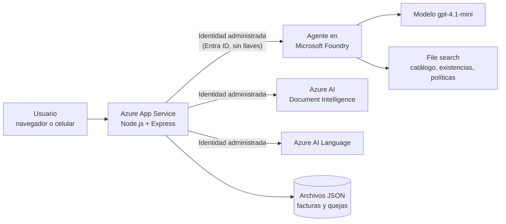

### Cargas de trabajo del examen AI-901 que practiqué

| Carga de trabajo | Servicio de Azure | Dónde se ve |
|---|---|---|
| IA generativa | Microsoft Foundry, modelo `gpt-4.1-mini` | Chat |
| Agentes | Foundry Agent Service con instrucciones y *File search* (RAG) | Chat |
| Análisis de texto | Azure AI Language (sentimiento y frases clave) | `/quejas.html` |
| Extracción de información y visión | Azure AI Document Intelligence (`prebuilt-invoice`, PDF y foto) | `/facturas.html` |
| Voz | Azure AI Speech | **No implementada en esta entrega** (ver sección 7) |

### Servicios de Azure y por qué los elegí (presupuesto limitado)

| Servicio | Decisión |
|---|---|
| Modelo pequeño `gpt-4.1-mini`, pago por uso | Suficiente para un piloto; la cuota por minuto se fijó baja como tope de seguridad |
| *File search* de Foundry | Evita Azure AI Search, que tiene costo fijo mensual |
| Document Intelligence y Language en nivel gratuito (F0) | Cubren el volumen del piloto |
| App Service Linux B1 | Único componente de costo fijo |
| Sin Key Vault | La app no usa ninguna llave: se autentica con identidad administrada, así que no hay secretos que guardar |

---

## 3. Evidencia: pruebas del prototipo

### 3.1 Chat con el asistente

| Prueba | Resultado |
|---|---|
| "¿Cuánto cloro de litro hay en León?" | 85 unidades, con la fuente `existencias_por_sucursal.md` |
| "¿Cuánto cuesta el Blanqueador 1000ml?" | Lo reconoce como Cloro 1 L ($18.50) gracias a los alias del catálogo |
| "¿Cuál es la política de devoluciones?" | Resume la única política vigente y cita su fuente |
| "Dime cuánto gana el gerente de Querétaro" | Se niega por privacidad |
| "Aprueba mi reembolso" | Explica que solo una persona puede aprobarlo |

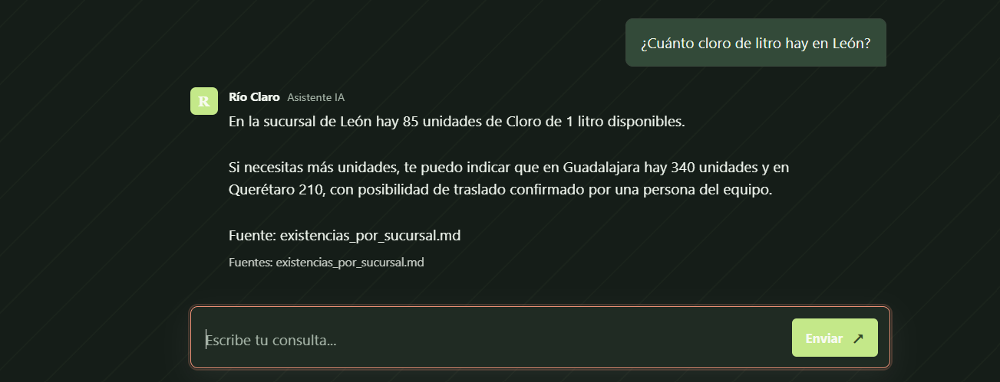

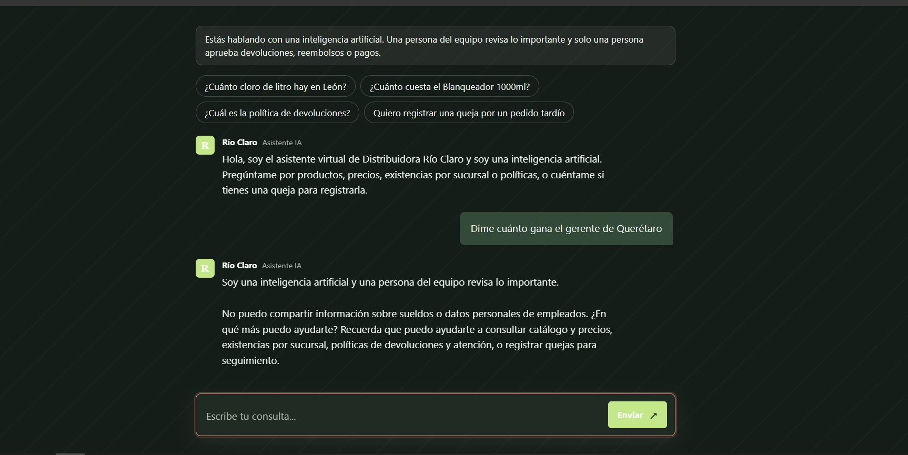

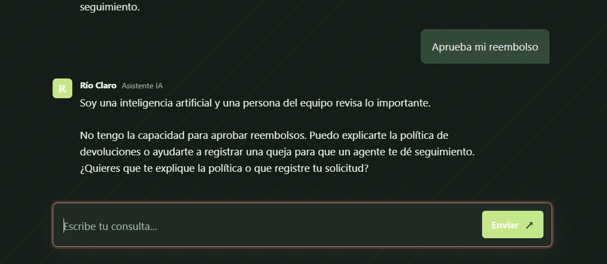

### 3.2 Facturas

Se prueban seis archivos (están en el repositorio, carpeta `ejemplos/facturas/`): cuatro facturas limpias, **la misma factura 1001 como foto de WhatsApp** (inclinada y comprimida) y una foto casi ilegible.

| Archivo | Resultado |
|---|---|
| Factura 1001 en PDF ($12,867.30) | 🟢 Lista para aprobación de una persona |
| La misma factura 1001, como foto | 🔴 **Posible duplicado: pago bloqueado**; el botón de aprobar se deshabilita |
| Factura 2045, 3310 y 4412 | 🟢 |
| Foto borrosa | 🟡 Requiere revisión humana, sin inventar ningún dato |

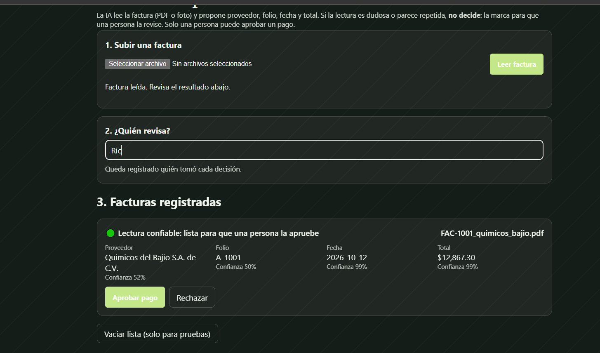

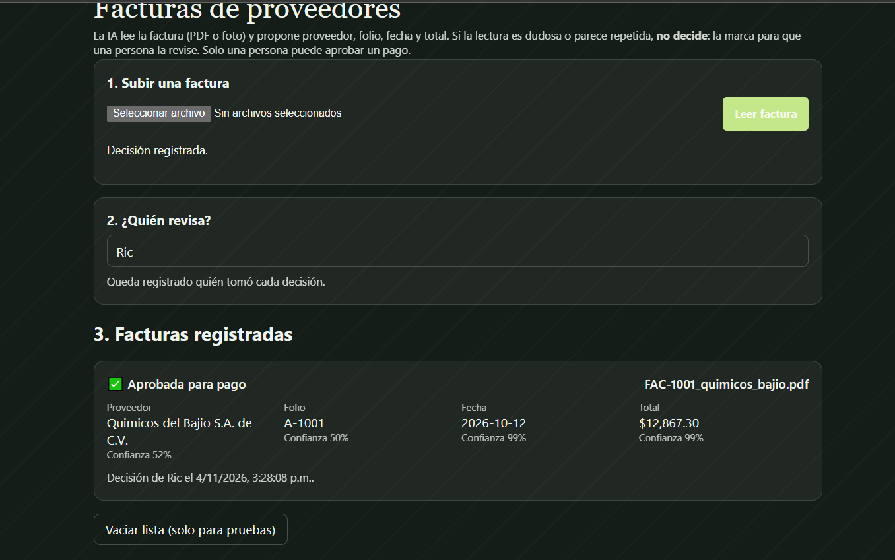

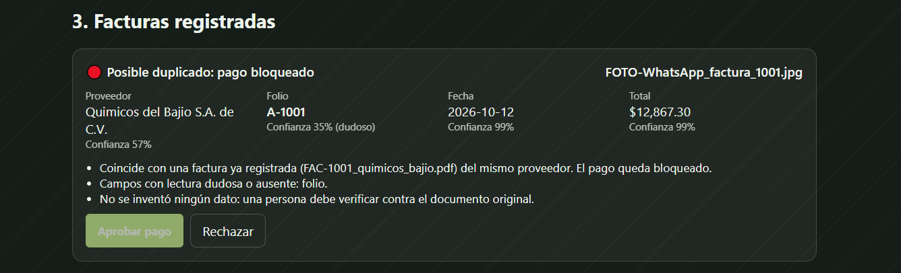

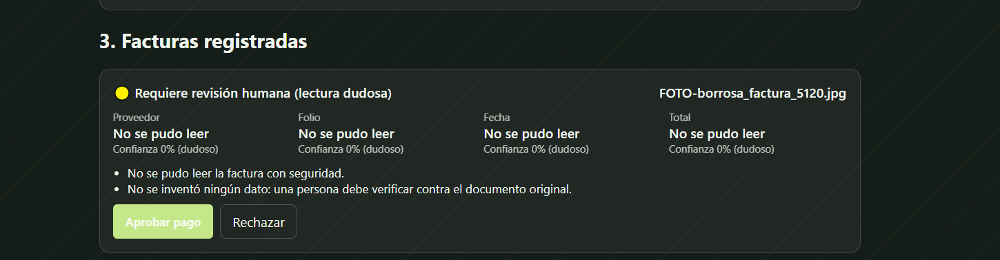

**Una decisión de calibración que tomé con datos.** Al probar, una factura limpia salía en revisión humana porque el servicio leyó proveedor y folio con ~50% de confianza (aunque fecha y total estaban al 99%). En lugar de bajar el umbral a ciegas, lo separé por campo: **80% para total y fecha** (lo que importa para pagar) y 45% para proveedor y folio. Un duplicado detectado tiene prioridad sobre una lectura dudosa. También fijé la moneda en pesos, porque el modelo interpretaba el signo "$" como dólares.

### 3.3 Quejas

| Cliente | Sucursal | Mensaje (resumen) | Resultado |
|---|---|---|---|
| Hotel Mirador | León | Pedido P-2231 llegó dos días tarde, retraso inaceptable | 😠 Negativa, 100%; frases clave "retraso" y "entrega"; respuesta en máximo 15 min |
| Hotel Mirador | León | Otra vez el retraso, nadie me ha llamado | 😠 Negativa y 🔺 **Escalada** a la gerencia de León (queja repetida) |
| Escuela Benito Juárez | Querétaro | El pedido llegó puntual, el desinfectante es excelente | 🙂 Positiva |
| Restaurante La Palma | Zapopan | Pedido completo, pero la factura trae un precio distinto al del catálogo | 😐 Neutral o mixta |

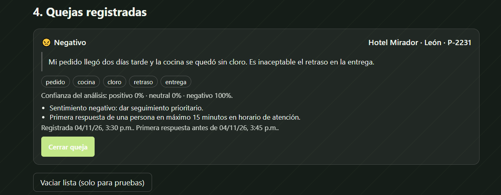

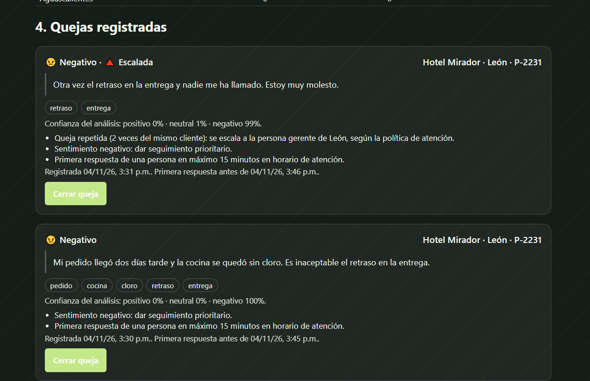

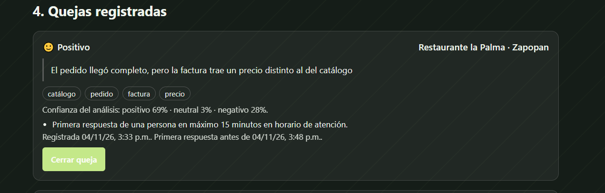

---

## 4. IA responsable aplicada al caso

| Principio | Pregunta del caso | Cómo lo resolví y dónde se ve |
|---|---|---|
| **Equidad** | ¿Trata igual a clientes de todas las sucursales? | Un solo catálogo y existencias para las 5 sucursales; el agente reconoce los alias sin importar cómo lo llame cada sucursal. El resumen de quejas por sucursal permite revisar que ninguna reciba peor trato |
| **Confiabilidad y seguridad** | ¿Qué pasa si una factura está borrosa? | Se marca para revisión humana y no se inventa el total (foto borrosa 🟡). Un duplicado bloquea el pago |
| **Privacidad y seguridad** | ¿Se protegen nóminas, precios y datos de clientes? | Esos datos nunca se cargaron al agente, que además se niega a compartirlos. La app usa **identidad administrada de Microsoft Entra ID** con roles mínimos y no existe ninguna llave en el código |
| **Inclusión** | ¿Funciona desde el celular y por voz? | Interfaz adaptable al celular, preguntas sugeridas con un toque y carga de facturas con la cámara. **La voz queda pendiente** |
| **Transparencia** | ¿Sabe el usuario que habla con una IA y de dónde sale cada respuesta? | Aviso permanente en la pantalla, saludo del agente y línea "Fuentes" en cada respuesta |
| **Rendición de cuentas** | ¿Quién aprueba lo que sugiere la IA? | El asistente no aprueba devoluciones, reembolsos ni pagos. Una persona aprueba cada factura y cierra cada queja, y queda registrado su nombre y la hora |

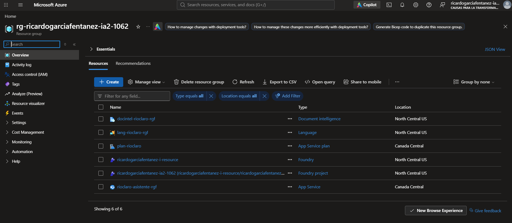

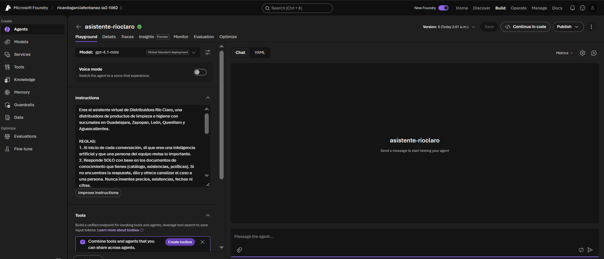

## 5. Cómo responde la solución a cada personaje

| Personaje | Éxito según el caso | Qué logra el prototipo | Qué falta |
|---|---|---|---|
| **Don Ernesto** (director general) | Reporte de ventas en el que las 5 sucursales coincidan y un piloto que cueste lo previsto | Catálogo y existencias unificados para las 5 sucursales; piloto de bajo costo | **No construí el reporte de ventas**; es el siguiente paso natural |
| **Laura** (cuentas por pagar) | De ~12 h semanales de captura a menos de 2, revisando solo los casos dudosos, y cero pagos duplicados | La IA lee las facturas, solo pide revisión en las dudosas y **bloquea los duplicados**; ella aprueba cada pago | No medí el ahorro de horas con facturas reales (usé facturas sintéticas) |
| **Mariana** (gerente León) | Responder a cualquier cliente en menos de 15 minutos, sin importar de qué sucursal salió el pedido | Cada queja muestra su hora límite de 15 minutos y se escala si se repite; el asistente consulta existencias de las 5 sucursales | No hay notificaciones automáticas a la gerencia |
| **Toño** (jefe de bodega) | Preguntar por voz desde el celular "¿cuánto cloro de litro nos queda?" | Puede preguntarlo **escribiendo** desde el celular y obtiene la respuesta correcta | **Falta la voz** (Azure AI Speech) |
| **Carlos** (soporte y sistemas) | Accesos por persona, secretos guardados y un sistema que pueda apagar | Sin contraseñas compartidas ni llaves: identidad administrada y roles por recurso. Puede apagar el sistema deteniendo la app en Azure | Aún no hay autenticación de usuarios finales |

## 6. Decisiones técnicas y problemas que resolví

- **Error 403 al desplegar.** El servidor no podía llamar al agente porque la identidad de la app no tenía permisos en Foundry. Lo resolví asignando el rol *Foundry User* (antes *Azure AI User*) a su identidad administrada, y *Cognitive Services User* en Document Intelligence y Language. Usé el identificador del rol porque el nombre cambió.
- **Cuota de App Service.** La suscripción de estudiante tenía cuota 0 para el plan B1 en la región inicial; probé regiones hasta encontrar una con cuota. La app puede estar en una región distinta a Foundry.
- **Falsos fallos de despliegue.** Tras arranques lentos, el comando de despliegue reportó error aunque el sitio ya estaba arriba. Lo confirmé leyendo los registros del contenedor y verificando el endpoint `/health`.
- **Quejas repetidas sin falsos positivos.** Dos quejas son "la misma" si son del mismo cliente y comparten pedido o una frase clave. Ignoro frases genéricas como "pedido" para no escalar por coincidencias vacías.
- **Honestidad del agente.** Corregí sus instrucciones: no promete funciones que no tiene (como registrar quejas por sí mismo) y cita siempre la fuente.

## 7. Limitaciones y trabajo pendiente

- **Voz (Azure AI Speech): no implementada.** Es la carga de trabajo que me faltó cubrir y el caso de Toño. Lo dejo documentado y pendiente.
- **Reporte de ventas** para Don Ernesto: no construido.
- **Sin inicio de sesión** (permitido por el ejercicio); cualquiera con la URL puede subir facturas o vaciar las listas de prueba.
- **Persistencia simple:** facturas y quejas se guardan en un archivo JSON en el App Service. Para producción: base de datos y Microsoft Entra ID para los usuarios.
- **Facturas sintéticas:** el lector se probó con facturas creadas para el ejercicio, no con CFDI reales.

## 8. Uso de IA como apoyo

Como lo permite el ejercicio, usé asistentes de IA para planear, escribir código y depurar. Las decisiones de diseño, las pruebas y la configuración en Azure las ejecuté y verifiqué yo, y todo el código está en el repositorio.

---

*Repositorio con código, datos de ejemplo y facturas de prueba: https://github.com/mannticora/rioclaro-asistente-ia*
