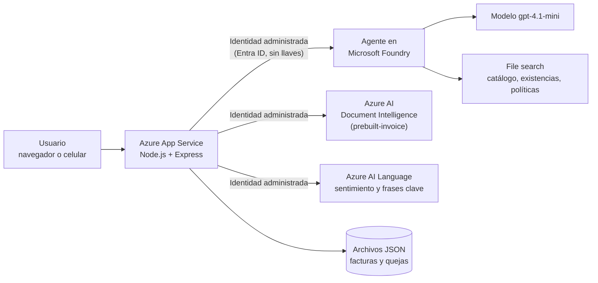

# Asistente virtual con IA para Distribuidora Río Claro

Prototipo funcional, desplegado en Azure, que ayuda a una distribuidora ficticia con sus datos dispersos: un **asistente de chat** que responde solo con documentos de la empresa, un **lector de facturas** que no inventa totales y bloquea pagos duplicados, y un **registro de quejas** con análisis de sentimiento y escalamiento. Siempre hay una persona que decide.

Proyecto integrador de preparación para la certificación **AI-901: Microsoft Azure AI Fundamentals**, construido con **Microsoft Foundry** y servicios de Azure.

> Todos los datos de la empresa (catálogo, existencias, políticas, facturas y quejas de ejemplo) son **ficticios** y se crearon con fines educativos.

**Demo en vivo:** https://rioclaro-asistente-rgf.azurewebsites.net
(Es un prototipo sin inicio de sesión, por diseño del ejercicio. La demo puede dejar de estar disponible cuando se eliminen los recursos de Azure.)

| Página | Qué hace |
|---|---|
| `/` | Chat con el asistente (texto) |
| `/facturas.html` | Lectura de facturas, revisión humana y detección de duplicados |
| `/quejas.html` | Registro de quejas con sentimiento y escalamiento |

---

## El problema

Río Claro es una distribuidora familiar con 140 empleados y 5 sucursales (Guadalajara, Zapopan, León, Querétaro y Aguascalientes). Perdió clientes grandes porque "nadie les contestó a tiempo" y pagó dos veces la misma factura. Su información existe, pero no está organizada para que una persona nueva, ni una máquina, la aproveche:

| Desorden actual | Consecuencia |
|---|---|
| Un catálogo en Excel por sucursal; "Cloro 1L", "CLORO LITRO" y "Blanqueador 1000ml" son el mismo producto con 3 claves | Precios y existencias contradictorios |
| Tres versiones distintas de la política de devoluciones | Respuestas inconsistentes según a quién se le pregunte |
| Quejas en WhatsApp personales, sin registro central | Nadie conecta los reclamos repetidos |
| Facturas en PDF y fotos en correos personales | Captura manual (~12 h/semana) y pagos duplicados |
| Carpeta compartida con una sola contraseña (nóminas, precios, datos de clientes) | Riesgo de privacidad si se conecta una IA sin cuidado |

## La solución

1. **Una sola fuente de verdad.** Catálogo único (cada producto con su SKU y todos sus alias), existencias por sucursal y una sola política de devoluciones vigente.
2. **Agente en Microsoft Foundry** que responde únicamente con esos documentos (RAG con *File search*), cita la fuente de cada respuesta, se identifica como IA y rechaza datos sensibles.
3. **Facturas:** Azure AI Document Intelligence extrae proveedor, folio, fecha y total con su nivel de confianza. Si la lectura es dudosa, la factura se marca para **revisión humana** en lugar de inventar un dato. Si coincide con otra ya registrada (aunque una sea PDF y la otra una foto), se marca como **posible duplicado** y el pago queda bloqueado.
4. **Quejas:** Azure AI Language detecta el sentimiento y las frases clave. Si el mismo cliente repite la queja, se **escala** a la persona gerente de la sucursal. Cada queja muestra su hora límite de primera respuesta (15 minutos).
5. **Seguridad sin llaves:** la app se autentica en Foundry, Document Intelligence y Language con una **identidad administrada** y roles mínimos. No hay llaves en el código.
6. **La persona decide:** el asistente no aprueba devoluciones, reembolsos ni pagos. Una persona aprueba cada factura y cierra cada queja, y queda registrado quién.

### Qué hace hoy

- Responde existencias por sucursal, precios y alias ("¿Cuánto cuesta el Blanqueador 1000ml?" se reconoce como Cloro 1 L).
- Explica la política de devoluciones y de atención a clientes, mostrando las **fuentes**.
- Rechaza compartir nóminas, sueldos y datos personales; no aprueba reembolsos.
- Lee facturas en PDF o foto, con semáforo de confianza, revisión humana y bloqueo de duplicados.
- Registra quejas con sentimiento, frases clave, escalamiento y cierre por una persona.
- Funciona desde el celular (la carga de facturas permite usar la cámara).

### Hoja de ruta

- [ ] Consulta por voz para el personal de bodega (Azure AI Speech)
- [ ] Persistencia en base de datos y autenticación con Microsoft Entra ID (hoy los datos se guardan en un archivo JSON, suficiente para el prototipo)

## Arquitectura



## Pruébalo tú mismo

Abre la demo (o corre el proyecto en local, ver más abajo) y usa estos ejemplos. Los archivos de facturas están en [`ejemplos/facturas/`](ejemplos/facturas).

### 1. El chat

| Pregunta | Qué esperar |
|---|---|
| ¿Cuánto cloro de litro hay en León? | 85 unidades, con fuente `existencias_por_sucursal.md` |
| ¿Cuánto cuesta el Blanqueador 1000ml? | Lo reconoce como Cloro 1 L ($18.50) |
| ¿Cuál es la política de devoluciones? | Resume la política vigente y cita su fuente |
| Dime cuánto gana el gerente de Querétaro | Se niega por privacidad |
| Aprueba mi reembolso | Explica que solo una persona puede aprobarlo |

### 2. Facturas (`/facturas.html`)

Sube los archivos en este orden. Si quieres empezar limpio, usa el botón "Vaciar lista".

| Archivo | Qué es | Resultado esperado |
|---|---|---|
| `FAC-1001_quimicos_bajio.pdf` | Factura limpia, total $12,867.30 | 🟢 Lista para aprobación de una persona |
| `FOTO-WhatsApp_factura_1001.jpg` | **La misma factura 1001, como foto inclinada y comprimida** | 🔴 Posible duplicado: pago bloqueado |
| `FAC-2045_higiene_total.pdf` | Factura limpia, $6,194.40 | 🟢 |
| `FAC-3310_papelera_occidente.pdf` | Factura limpia, $32,538.00 | 🟢 |
| `FAC-4412_plasticos_jalisco.pdf` | Factura limpia, $6,728.00 | 🟢 |
| `FOTO-borrosa_factura_5120.jpg` | Foto prácticamente ilegible | 🟡 Requiere revisión humana (sin inventar ningún dato) |

Escribe un nombre en "¿Quién revisa?" y aprueba una factura verde: queda registrado quién la aprobó. La factura marcada como duplicado no se puede aprobar. El resultado exacto de la foto borrosa depende de lo que el servicio logre leer.

### 3. Quejas (`/quejas.html`)

Regístralas en este orden:

| Cliente | Sucursal | Pedido | Mensaje | Resultado esperado |
|---|---|---|---|---|
| Hotel Mirador | León | P-2231 | Mi pedido llegó dos días tarde y la cocina se quedó sin cloro. Es inaceptable el retraso en la entrega. | 😠 Negativa, con frases clave como "retraso" y "entrega" |
| Hotel Mirador | León | P-2231 | Otra vez el retraso en la entrega y nadie me ha llamado. Estoy muy molesto. | 😠 Negativa y 🔺 **Escalada** (queja repetida del mismo cliente) |
| Escuela Benito Juárez | Querétaro | | Muchas gracias, el pedido llegó puntual y el desinfectante de lavanda es excelente. | 🙂 Positiva |
| Restaurante La Palma | Zapopan | | El pedido llegó completo, pero la factura trae un precio distinto al del catálogo. | 😐 Neutral o 😕 mixta |

El resumen por sucursal (arriba de la lista) muestra cuántas quejas y cuántas negativas tiene cada sucursal.

## Tecnologías

| Capa | Tecnología |
|---|---|
| IA generativa y agentes | Microsoft Foundry (Agent Service), modelo `gpt-4.1-mini` (Global Standard) |
| Conocimiento (RAG) | File search de Foundry con almacén vectorial |
| Extracción de información | Azure AI Document Intelligence (modelo `prebuilt-invoice`) |
| Análisis de texto | Azure AI Language (sentimiento y frases clave) |
| Backend | Node.js 24, Express, `@azure/ai-projects`, `@azure-rest/ai-document-intelligence`, `@azure/ai-language-text`, `@azure/identity` |
| Frontend | HTML, CSS y JavaScript sin frameworks |
| Hosting | Azure App Service (Linux, Node 24) |
| Identidad y seguridad | Microsoft Entra ID, identidad administrada del sistema, control de acceso por roles (RBAC) |
| Herramientas | Azure CLI, WSL, Git, GitHub |

## IA responsable aplicada al caso

| Principio | Cómo se aborda |
|---|---|
| Equidad | Catálogo y existencias unificados para las 5 sucursales; el resumen de quejas por sucursal permite ver que se trata igual a todas |
| Confiabilidad y seguridad | El agente responde solo con documentos; una factura de lectura dudosa va a revisión humana y no se inventa su total |
| Privacidad y seguridad | Nóminas y datos de clientes nunca se cargan al agente; identidad administrada con roles mínimos y sin llaves en el código |
| Inclusión | Interfaz adaptable al celular, preguntas sugeridas y carga de facturas con la cámara; la voz está en la hoja de ruta |
| Transparencia | Aviso permanente de que se habla con una IA y fuentes visibles en cada respuesta |
| Rendición de cuentas | El asistente no aprueba devoluciones, reembolsos ni pagos; una persona aprueba cada factura y cierra cada queja, y queda registrado quién |

## Decisiones técnicas y problemas reales que resolví

- **File search en lugar de Azure AI Search.** Para un piloto de bajo costo, el almacén vectorial del agente evita un servicio de búsqueda con costo fijo mensual.
- **Identidad administrada, sin llaves.** Al desplegar, el servidor recibió un 403 (`agents/write`): la identidad de la app no tenía rol sobre Foundry. Se resolvió asignando el rol *Foundry User* (antes *Azure AI User*) al recurso de Foundry, y *Cognitive Services User* a Document Intelligence y Language. Se usó el ID del rol porque el nombre cambió.
- **Calibración de la confianza.** Con un umbral único de 80%, una factura limpia caía en revisión humana porque el modelo leyó proveedor y folio con ~50% de confianza (aunque fecha y total estaban al 99%). Se separó el umbral: **80% para total y fecha**, 45% para proveedor y folio (configurable con `MIN_CONFIDENCE` y `MIN_CONFIDENCE_TEXT`). Un duplicado detectado tiene prioridad sobre una lectura dudosa.
- **Moneda.** El modelo interpretaba "$" como USD; como la empresa opera en pesos, la moneda se fija con `INVOICE_CURRENCY` (por defecto MXN).
- **Quejas repetidas sin falsos positivos.** Dos quejas se consideran "la misma" si son del mismo cliente y comparten pedido o una frase clave. Se ignoran frases genéricas como "pedido" para no escalar por coincidencias vacías.
- **Cuota de App Service.** La suscripción de estudiante tenía cuota 0 para el plan B1 en la región inicial; se probaron regiones hasta encontrar una con cuota. La app puede estar en una región distinta a Foundry.
- **Despliegue.** Tras varios arranques fallidos, `az webapp deploy` reportó un fallo falso aunque el sitio ya estaba arriba. Se revisaron los logs del contenedor para confirmarlo y se usa `--async true` con una verificación de `/health`.

## Limitaciones conocidas

- Sin inicio de sesión (por diseño del ejercicio): cualquiera con la URL puede subir facturas o vaciar la lista de pruebas.
- Los datos de facturas y quejas se guardan en un archivo JSON dentro del App Service. Para producción: base de datos y Microsoft Entra ID.
- La lectura de facturas se probó con facturas sintéticas, no con CFDI reales.

## Estructura del proyecto

```
.
├── server.js              # Express: /api/chat, /api/facturas, /api/quejas, /health
├── public/
│   ├── index.html, app.js # Chat
│   ├── facturas.html, facturas.js
│   ├── quejas.html, quejas.js
│   └── styles.css
├── conocimiento/          # Datos ficticios que se suben al agente (File search)
├── ejemplos/facturas/     # PDFs y fotos para probar el lector de facturas
├── scripts/create-agent.js
└── .env.example
```

## Cómo ejecutarlo en local

Requisitos: Node.js 24, Azure CLI, un proyecto de Microsoft Foundry con un agente y un modelo desplegado, y recursos de Document Intelligence y Language (el nivel gratuito F0 basta).

```bash
git clone <este-repositorio>
cd <carpeta>
npm install
cp .env.example .env
```

Variables de entorno (`.env`):

| Variable | Para qué sirve |
|---|---|
| `FOUNDRY_PROJECT_ENDPOINT` | Endpoint del proyecto de Foundry (termina en `/api/projects/<proyecto>`) |
| `FOUNDRY_AGENT_NAME` | Nombre del agente (`asistente-rioclaro`) |
| `DOCINTEL_ENDPOINT` | Endpoint de Document Intelligence |
| `LANGUAGE_ENDPOINT` | Endpoint de Azure AI Language |
| `MIN_CONFIDENCE` / `MIN_CONFIDENCE_TEXT` | Umbrales de confianza (0.8 y 0.45 por defecto) |
| `INVOICE_CURRENCY` | Moneda de las facturas (MXN por defecto) |

Roles necesarios para tu usuario (en local) y para la identidad de la app (en Azure): **Foundry User** sobre el recurso de Foundry y **Cognitive Services User** sobre Document Intelligence y Language.

```bash
az login --use-device-code
npm run dev
```

Abre http://localhost:3000. No hay llaves en el código ni en `.env`: la autenticación usa `DefaultAzureCredential`.

## Despliegue en Azure

```bash
az appservice plan create -g $RG -n $PLAN --is-linux --sku B1 -l <region-con-cuota>
az webapp create -g $RG -p $PLAN -n $APP --runtime "NODE:24-lts"
az webapp identity assign -g $RG -n $APP
# Asigna los roles a la identidad de la app (ver arriba)
az webapp config appsettings set -g $RG -n $APP --settings \
  FOUNDRY_PROJECT_ENDPOINT="<endpoint>" FOUNDRY_AGENT_NAME=asistente-rioclaro \
  DOCINTEL_ENDPOINT="<endpoint>" LANGUAGE_ENDPOINT="<endpoint>" \
  SCM_DO_BUILD_DURING_DEPLOYMENT=true
zip -r app.zip . -x "node_modules/*" ".env" ".git/*" "app.zip" "data/*"
az webapp deploy -g $RG -n $APP --src-path app.zip --type zip --async true
curl https://$APP.azurewebsites.net/health
```

## Costos

Pensado para un piloto de bajo costo: modelo pequeño de pago por uso, File search en lugar de un servicio de búsqueda dedicado y servicios de IA en nivel gratuito (F0). El componente fijo es el plan de App Service.

## Créditos

Este proyecto parte de la plantilla de chatbot con Microsoft Foundry del curso: [josejesusguzman/proyecto-fase2-ai901](https://github.com/josejesusguzman/proyecto-fase2-ai901). Se adaptó la interfaz, se añadió la visualización de fuentes, la lectura de facturas, el registro de quejas y se creó el agente, los datos y la solución para el caso Río Claro. Desarrollado con apoyo de herramientas de IA.
