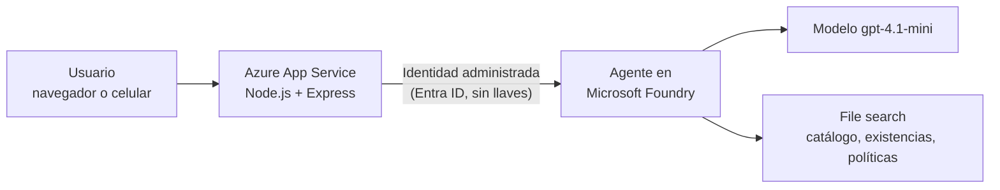

# Asistente virtual con IA para Distribuidora Río Claro

Prototipo funcional de un asistente de IA para **Distribuidora Río Claro**, una empresa ficticia que tiene sus datos dispersos y quiere responder a clientes y empleados en minutos, no en días. Proyecto integrador de preparación para la certificación **AI-901: Microsoft Azure AI Fundamentals**, construido con **Microsoft Foundry** y servicios de Azure.

> Todos los datos de la empresa (catálogo, existencias, políticas) son **ficticios** y se crearon con fines educativos.

**Demo:** https://rioclaro-asistente-rgf.azurewebsites.net

---

## El problema

Río Claro es una distribuidora familiar con 140 empleados y 5 sucursales (Guadalajara, Zapopan, León, Querétaro y Aguascalientes). Perdió clientes grandes porque "nadie les contestó a tiempo", y su información existe pero no está organizada para que una persona nueva, ni una máquina, la aproveche:

| Desorden actual | Consecuencia |
|---|---|
| Un catálogo en Excel por sucursal; "Cloro 1L", "CLORO LITRO" y "Blanqueador 1000ml" son el mismo producto con 3 claves | Precios y existencias contradictorios |
| Tres versiones distintas de la política de devoluciones | Respuestas inconsistentes según a quién se le pregunte |
| Quejas en WhatsApp personales, sin registro central | Nadie conecta los reclamos repetidos |
| Facturas en PDF y fotos en correos personales | Captura manual (~12 h/semana) y pagos duplicados |
| Carpeta compartida con una sola contraseña (nóminas, precios, datos de clientes) | Riesgo de privacidad si se conecta una IA sin cuidado |

## La solución

Un **asistente de chat** que responde únicamente con base en documentos curados de la empresa (técnica RAG), cita de qué documento sale cada respuesta y se identifica siempre como inteligencia artificial.

1. **Una sola fuente de verdad.** Se crea un catálogo único donde cada producto tiene una clave (SKU) y todos sus alias. Se publica una sola política de devoluciones vigente y una política de atención a clientes.
2. **Un agente en Microsoft Foundry** con instrucciones claras: responder solo con los documentos, no inventar cifras, tratar igual a todas las sucursales y rechazar datos sensibles.
3. **Una app web** (Node.js) desplegada en Azure App Service que habla con el agente. El navegador nunca ve credenciales.
4. **Seguridad sin llaves:** la app se autentica en Foundry con una **identidad administrada** y el rol mínimo necesario (Foundry User, antes Azure AI User).
5. **La persona decide:** el asistente no aprueba devoluciones, reembolsos ni pagos. Solo los registra y los canaliza a un humano.

### Qué hace hoy

- Responde existencias por sucursal, precios y alias de productos ("¿Cuánto cuesta el Blanqueador 1000ml?" se reconoce como Cloro 1 L).
- Explica la política de devoluciones y de atención a clientes.
- Muestra las **fuentes** (nombre del documento) de cada respuesta.
- Rechaza compartir nóminas, sueldos y datos personales.
- Indica que solo una persona aprueba reembolsos.
- Conserva el contexto entre mensajes de una misma conversación.
- Funciona desde el celular y ofrece preguntas sugeridas con un toque.

### Hoja de ruta

- [ ] Extracción de facturas (Azure AI Document Intelligence) con revisión humana y detección de pagos duplicados
- [ ] Registro de quejas con análisis de sentimiento (Azure AI Language)
- [ ] Consulta por voz para el personal de bodega (Azure AI Speech)

## Arquitectura



Flujo: el navegador envía el mensaje a `POST /api/chat`; el servidor obtiene un token con `DefaultAzureCredential`, llama al agente de Foundry, el agente busca en los documentos y responde; el servidor devuelve el texto, el identificador de conversación y las fuentes.

## Tecnologías

| Capa | Tecnología |
|---|---|
| IA generativa y agentes | Microsoft Foundry (Agent Service), modelo `gpt-4.1-mini` (Global Standard) |
| Conocimiento (RAG) | File search de Foundry con almacén vectorial |
| Backend | Node.js 24, Express, `@azure/ai-projects`, `@azure/identity` |
| Frontend | HTML, CSS y JavaScript sin frameworks |
| Hosting | Azure App Service (Linux, Node 24) |
| Identidad y seguridad | Microsoft Entra ID, identidad administrada asignada por el sistema, control de acceso por roles (RBAC) |
| Herramientas | Azure CLI, WSL, Git, GitHub |

## IA responsable aplicada al caso

| Principio | Cómo se aborda |
|---|---|
| Equidad | Catálogo y existencias unificados para las 5 sucursales; mismo trato sin importar qué sucursal surtió el pedido |
| Confiabilidad y seguridad | El agente responde solo con documentos y admite cuando no tiene la información |
| Privacidad y seguridad | Nóminas y datos de clientes nunca se cargan al agente; autenticación con identidad administrada y rol mínimo; el agente rechaza datos sensibles |
| Inclusión | Interfaz adaptable al celular y preguntas sugeridas; la voz está en la hoja de ruta |
| Transparencia | Aviso permanente de que se habla con una IA y fuentes visibles en cada respuesta |
| Rendición de cuentas | El asistente no aprueba devoluciones, reembolsos ni pagos; una persona revisa y decide |

## Estructura del proyecto

```
.
├── server.js            # Servidor Express: /health y /api/chat (llama al agente de Foundry)
├── public/
│   ├── index.html       # Interfaz del chat
│   ├── app.js           # Lógica del navegador (mensajes, fuentes, preguntas sugeridas)
│   └── styles.css       # Estilos
├── scripts/
│   └── create-agent.js  # Crea el agente en Foundry si no existe
├── conocimiento/        # Datos ficticios que se suben al agente (File search)
└── .env.example         # Plantilla de variables de entorno
```

## Cómo ejecutarlo

Requisitos: Node.js 24, Azure CLI, y un proyecto de Microsoft Foundry con un agente y un modelo desplegado.

```bash
git clone <este-repositorio>
cd <carpeta>
npm install
cp .env.example .env
```

Edita `.env`:

```
FOUNDRY_PROJECT_ENDPOINT=https://<tu-recurso>.services.ai.azure.com/api/projects/<tu-proyecto>
FOUNDRY_AGENT_NAME=asistente-rioclaro
```

Inicia sesión en Azure y arranca:

```bash
az login --use-device-code
npm run dev
```

Abre http://localhost:3000. No hay llaves en el código ni en `.env`: la autenticación usa `DefaultAzureCredential`.

## Despliegue en Azure

```bash
RG=<grupo-de-recursos>
APP=<nombre-unico-de-la-app>
PLAN=plan-rioclaro

az appservice plan create -g $RG -n $PLAN --is-linux --sku B1 -l <region>
az webapp create -g $RG -p $PLAN -n $APP --runtime "NODE:24-lts"

# Identidad administrada y permiso sobre el recurso de Foundry
PRINCIPAL=$(az webapp identity assign -g $RG -n $APP --query principalId -o tsv)
SCOPE=$(az cognitiveservices account show -g $RG -n <recurso-foundry> --query id -o tsv)
az role assignment create --assignee-object-id $PRINCIPAL \
  --assignee-principal-type ServicePrincipal \
  --role 53ca6127-db72-4b80-b1b0-d745d6d5456d --scope $SCOPE   # Foundry User

az webapp config appsettings set -g $RG -n $APP --settings \
  FOUNDRY_PROJECT_ENDPOINT="<endpoint>" FOUNDRY_AGENT_NAME=asistente-rioclaro \
  SCM_DO_BUILD_DURING_DEPLOYMENT=true

zip -r app.zip . -x "node_modules/*" ".env" ".git/*" "app.zip"
az webapp deploy -g $RG -n $APP --src-path app.zip --type zip
```

## Costos

Pensado para un piloto de bajo costo: modelo pequeño de pago por uso, File search en lugar de un servicio de búsqueda dedicado, y servicios de IA en nivel gratuito cuando existe. El componente fijo es el plan de App Service.

## Créditos

Este proyecto parte de la plantilla de chatbot con Microsoft Foundry del curso: [josejesusguzman/proyecto-fase2-ai901](https://github.com/josejesusguzman/proyecto-fase2-ai901). Se adaptó la interfaz, se añadió la visualización de fuentes y se creó el agente, los datos y la solución para el caso Río Claro. Desarrollado con apoyo de herramientas de IA.
